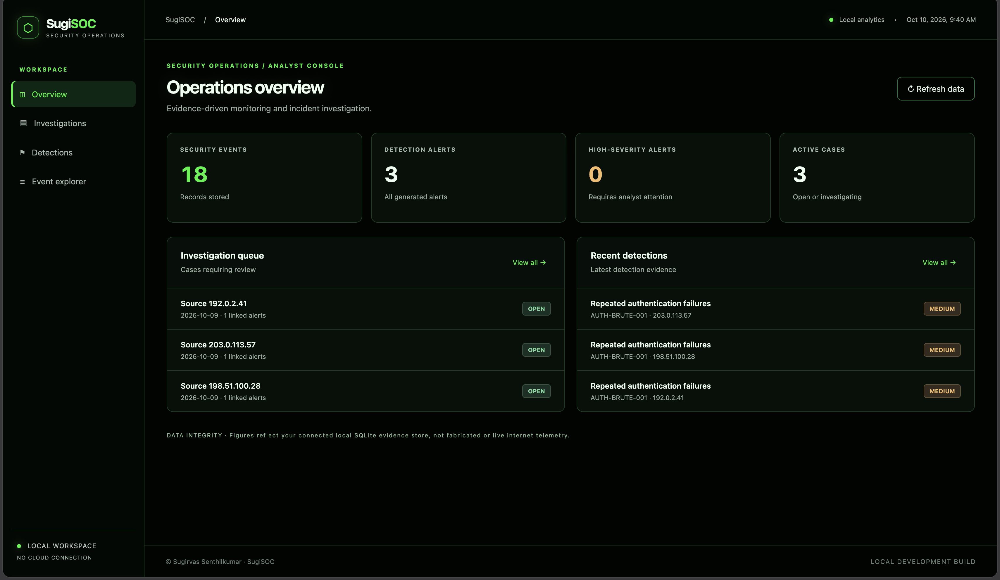
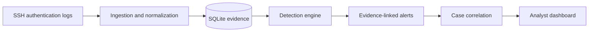
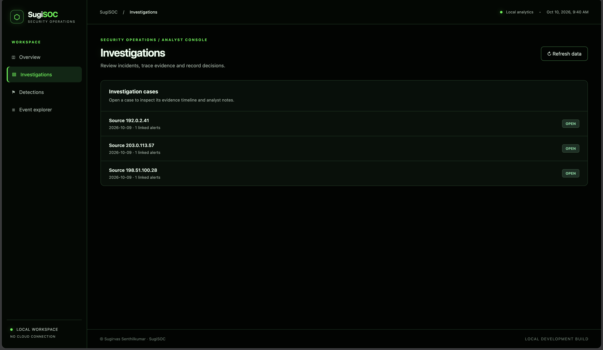
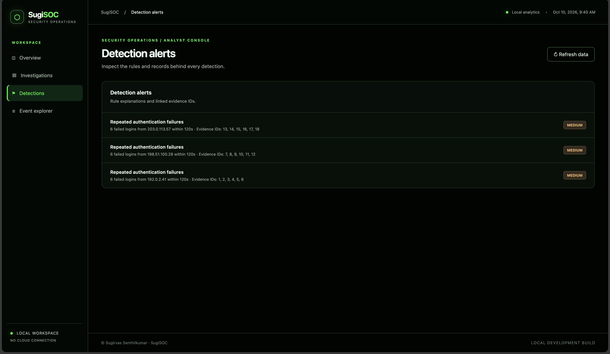
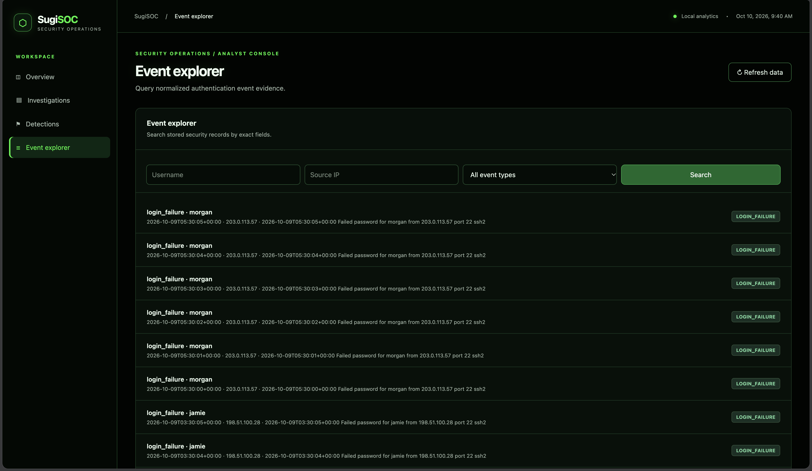
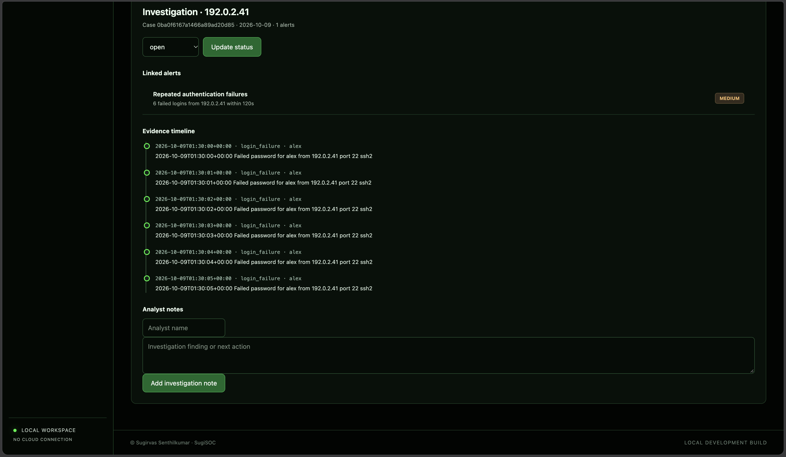

# SugiSOC

**A Python-based SOC monitoring, threat detection, and incident investigation project.**

**Developed by Sugirvas Senthilkumar**

SugiSOC is a hands-on defensive cybersecurity project demonstrating how authentication logs can be collected, normalized, analyzed, correlated into incidents, and investigated through a browser dashboard.

The platform was developed as a learning and portfolio project focused on practical SOC Analyst workflows.

> **Project status:** Local research/lab implementation with a separately tested, private, read-only demonstration. Not a production SIEM.


## SugiSOC in Action

**Actual SugiSOC interface · Isolated synthetic dataset**



The dashboard presents **18 synthetic authentication events, 3
evidence-backed alerts and 3 correlated investigation cases**.

The screenshot shows the real SugiSOC application, not production telemetry.

## Engineering Showcase

**Start here:** Follow an authentication incident from raw evidence to an
investigation case using SugiSOC's actual processing pipeline.

- [Incident investigation walkthrough](docs/DEMO_WALKTHROUGH.md)
- [System architecture](docs/ARCHITECTURE.md)
- [Threat model and trust boundaries](docs/THREAT_MODEL.md)
- [Security limitations](docs/SECURITY.md)

### Detection-to-investigation workflow



### Reproducible laboratory evidence

| Validation | Observed result |
| --- | --- |
| Controlled Kali SSH investigation | 9 stored events, 1 alert, 1 case |
| Independent synthetic dataset | 18 events, 3 alerts, 3 cases |
| Synthetic evidence replay | No duplicate events, alerts, or cases |
| Private read-only demo | HTTPS verified through Tailscale Serve |
| Write protection | Rejected write requests verified |
| Git history and working-tree secret scans | Gitleaks checks passed |

**Interpretation:** These results demonstrate the tested workflow and
specific laboratory scenarios. They do not establish production detection
accuracy, coverage, or enterprise deployment readiness.

### Demonstration availability

The verified Tailscale HTTPS instance is **private** and is not accessible
to general GitHub visitors. The repository contains the code and technical
walkthrough, not the underlying private Kali evidence or local databases.

### What I engineered

- A Python pipeline for collecting and normalizing authentication evidence
- Persistent event, alert, and correlated-case records
- Authentication detections with evidence references and ATT&CK mappings
- Replay-safe ingestion exercised by automated integration tests
- A local investigation API and interactive analyst dashboard
- An opt-in, read-only demonstration mode with regression tests

**Author:** Sugirvas Senthilkumar

## Features

- Authentication-log ingestion and normalized event storage
- SQLite-backed event, alert, and investigation records
- Detection of suspicious authentication activity
- Advanced detection logic with MITRE ATT&CK mappings
- Evidence-backed alert and case correlation
- Investigation views with linked security events
- Analyst case-status and note workflows in local mode
- Replay-safe log ingestion and detection tests
- Local browser dashboard with a dark, green-accented interface
- Optional read-only API mode for controlled demonstrations

## Architecture

```text
Authentication logs
        |
        v
Collection and ingestion
        |
        v
Normalization and SQLite evidence store
        |
        v
Detection and alert generation
        |
        v
Incident correlation and case records
        |
        v
Local Python HTTP API
        |
        v
SugiSOC analyst dashboard
```

For implementation details, see [Architecture](docs/ARCHITECTURE.md).

## Validated laboratory results

The project has been exercised using actual SSH authentication evidence collected from a controlled Kali Linux laboratory environment.

A separate synthetic demonstration dataset produced:

| Result | Count |
| --- | ---: |
| Simulated authentication events | 18 |
| Detection alerts | 3 |
| Correlated investigation cases | 3 |

The synthetic dataset was processed using the project's detection and correlation pipeline. Replay testing confirmed that processing the same evidence again did not introduce duplicate events, alerts, or cases.

These are **laboratory validation results**, not production detection-performance benchmarks.

## Run locally

Requirements: Python compatible with the project configuration and dependencies declared in `pyproject.toml`.

From the repository root, after setting up the Python environment and installing the project dependencies:

```bash
python -m sugisoc.api.server --database .collection-state/sugisoc.sqlite3
```

Open `http://127.0.0.1:8765/`.

The application binds to the local loopback interface. Its default mode includes writable investigation functionality and does **not** implement user authentication. Do not expose this default mode to the public internet.

For an existing isolated demo database, start read-only mode with:

```bash
python -m sugisoc.api.server --database .collection-state/sugisoc-demo.sqlite3 --port 8766 --read-only
```

The demo database is generated locally and is intentionally not distributed with the source repository.

## Testing

With project test dependencies installed:

```bash
python -m pytest -q
python -m ruff check .
```

The automated tests cover ingestion, event processing, detection, correlation, selected API security controls, and read-only mode.

## Project structure

```text
backend/sugisoc/   Python backend and detection pipeline
frontend/          Analyst dashboard
tests/             Unit and integration tests
docs/              Technical documentation
scripts/           Local validation utilities
.github/workflows/ Continuous integration configuration
```

## Security and privacy

See [Security and limitations](docs/SECURITY.md).

Real investigation evidence, local SQLite databases, generated logs, and credentials are excluded from Git tracking. Never upload private logs or credentials when reproducing demonstrations.

## Project scope

SugiSOC is an educational SOC engineering project. It is not a replacement for a commercial SIEM and has not undergone a production security assessment. Additional authentication, authorization, monitoring, resilience, and deployment controls would be required before any broader deployment.

## Product Screenshots

The following screenshots show the real SugiSOC interface operating on
an isolated **synthetic authentication-event dataset**. They do not
represent production monitoring or expose the private Kali lab evidence.

### Operations overview

[View the operations overview above](#sugisoc-in-action)

### Investigation queue



### Evidence-backed detections



### Event Explorer



### Investigation evidence timeline



**Demo limitation:** Investigation controls are visible in the
read-only interface, but case-status and note-write requests are rejected.


## Author

**Sugirvas Senthilkumar**

Cybersecurity | SOC Analysis | Python | Defensive Security

[GitHub — SUGIRVASS](https://github.com/SUGIRVASSENTHILKUMAR)
