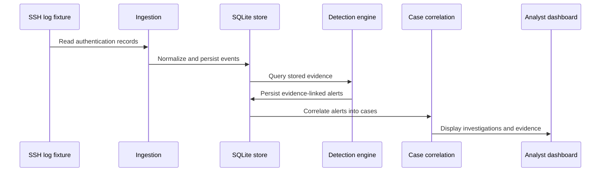

# Incident Investigation Walkthrough

**SugiSOC — Technical demonstration**

This walkthrough describes a controlled authentication-threat scenario,
showing how the existing project components support a SOC investigation.

## Scenario

A simulated account receives repeated failed SSH authentication attempts
from a documentation-only source address.

The separate synthetic demo contains 18 authentication events across
three scenarios and produced three alerts and three cases.

No real hosts were attacked to generate these synthetic events.

## Evidence-to-case sequence

## Steps demonstrated

1. **Collection:** Authentication messages are supplied as a local file.
2. **Normalization:** Events are converted to consistent records.
3. **Detection:** Repeated suspicious authentication activity triggers alerts.
4. **Correlation:** Related alerts become investigation cases.
5. **Investigation:** The dashboard exposes the case and supporting events.
6. **Replay:** Re-importing the same fixture introduces no new records,
   alerts, or cases in the tested scenario.

## Measured laboratory outcomes

| Dataset | Events | Alerts | Cases |
| --- | ---: | ---: | ---: |
| Controlled Kali SSH evidence | 9 | 1 | 1 |
| Synthetic read-only demo | 18 | 3 | 3 |

The controlled Kali dataset included six deliberately generated failed
authentication attempts and three earlier legitimate events. The synthetic
dataset uses three distinct groups of failed authentication attempts.

These numbers describe tested datasets, not generalized threat-detection
performance.

## Local analyst workflow

With the normal localhost dashboard, analysts can inspect events, open
cases, change investigation status, and add notes.

The separate `--read-only` demo denies case-status and note-write POST
requests. It is designed for viewing synthetic evidence without editing it.

## What a reviewer can verify

- Source code for event collection, normalization, and detection
- Evidence storage and correlation implementation
- API endpoint definitions and security tests
- Automated integration tests for replay-safe processing
- Frontend source code for alert and investigation views

## Further work

A production-oriented implementation would require authentication,
authorization, improved request validation, operational observability,
broader telemetry coverage, and systematic detection evaluation.
