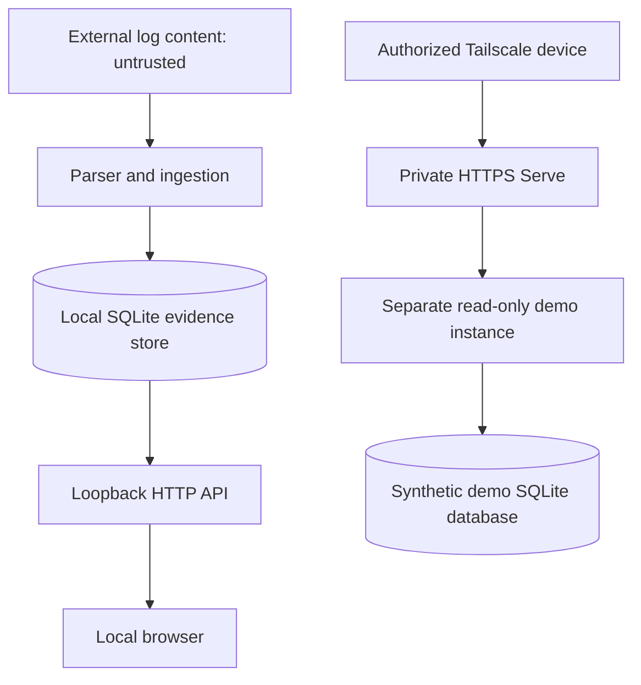

# Threat Model and Trust Boundaries

## Scope

SugiSOC is a local, educational SOC investigation platform. This document
covers the current laboratory implementation and private synthetic demo.

## Assets requiring protection

- Authentication event records
- Linked alert evidence and correlated cases
- Analyst-written investigation notes
- Local SQLite databases and checkpoint files
- Host filesystem and local development credentials

## Trust boundaries

### Boundary 1 — Log ingestion

Input log contents are untrusted. Parsing and validation should not assume
that arbitrary strings are safe or that every source record is authentic.

### Boundary 2 — Local API

The default API binds to `127.0.0.1` and has no built-in user authentication.
Its browser-origin guard is not an authorization mechanism. Do not expose
the writable default mode on an untrusted network.

### Boundary 3 — Private demonstration

Tailscale Serve forwards private HTTPS requests to a separate server
launched with `--read-only`. The demo uses synthetic evidence rather than
the genuine Kali lab database.

Tailnet access policies restrict network reachability, but do not replace
application-level authorization. A tailnet user's permitted devices may
have network access according to the configured grants.

### Boundary 4 — Repository publication

Private evidence files, generated logs, local state and credentials must
not enter source control. Ignore rules and secret scanners provide
defense in depth, not a guarantee of sensitive-data absence.

## Current limitations

- No application authentication or role-based access control
- No independent security assessment
- No production incident response or availability guarantees
- No claim of complete ATT&CK or detection coverage
- Read-only mode blocks implemented POST write paths; this is not a
  general-purpose authentication or authorization system

## Safe demonstration rules

Use documentation-only source IPs for fixtures. Keep real Kali evidence
outside Git. Never enable public Funnel for the private demo. Review
deployment configuration and repository history before public release.
